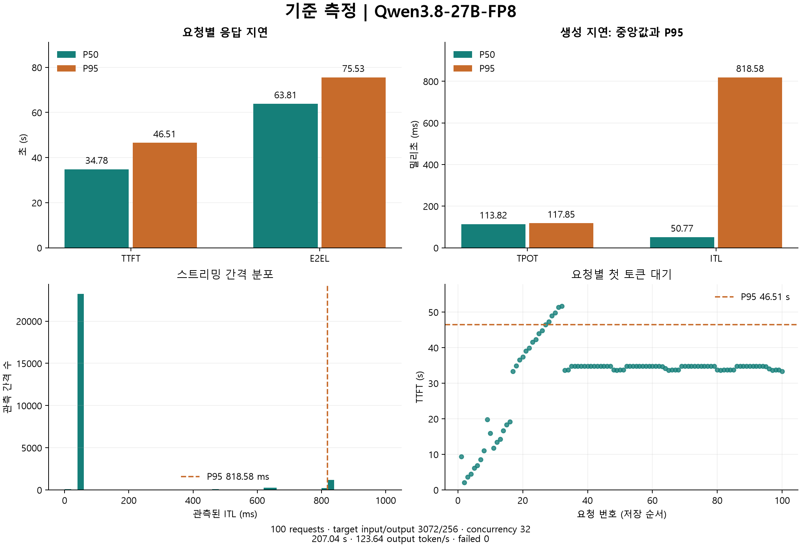

# vLLM 벤치마크 · 클라우드 인계

Qwen/Qwen3.8-27B-FP8를 L40S 1장에서 서비스하고, 설정별 지연·처리량을 비교하는 입문 과제입니다.
최종 결과물은 실제 측정값과 그래프를 포함한 간략한 Word 보고서입니다.

## 현재 상태 — 2026-10-15

- **완료:** 기준 B0와 `max-num-seqs`, `max-num-batched-tokens`, `gpu-memory-utilization`, `max-model-len`, `enforce-eager` 비교 및 Prefix Caching OFF/ON 측정.
- 최종 요약 보고서: [보고서/vLLM_벤치마킹_보고서.docx](보고서/vLLM_벤치마킹_보고서.docx)
- 개별 측정 원본: `벤치마킹 결과/`; 비교 요약: `보고서/verified_results.json` 및 `보고서/comparison.png`.
- FP8 양자화 실습 과정 보고서: [보고서/Qwen2.5_7B_FP8_양자화_실습정리.docx](보고서/Qwen2.5_7B_FP8_양자화_실습정리.docx).
- 현재 GPU 서버에서 진행 중인 측정은 없습니다.
- 서버 로그 파일 제출은 사용자가 원하지 않습니다. 다시 필수 요구하지 마세요.

## 클라우드 작업 시작

1. 이 저장소를 작업 환경에 연결합니다.
2. [CLOUD_PROMPT.md](CLOUD_PROMPT.md) 내용을 새 작업의 첫 프롬프트로 붙여 넣습니다.
3. 에이전트는 [AGENTS.md](AGENTS.md)를 먼저 읽습니다.
4. 추가 측정 요청 시 기존 결과 조건과 비교 가능성을 먼저 확인합니다.

클라우드 분석 환경에 L40S나 원격 서버 접속이 있다고 가정하지 않습니다.
사용자는 기존 GPU 서버에서 벤치마크를 실행하고 결과를 제공합니다.

## 주요 파일

| 파일 | 역할 |
|---|---|
| AGENTS.md | 확정 상태, 사용자 선호, 실험 통제 및 해석 원칙 |
| CLOUD_PROMPT.md | 새 클라우드 작업에 입력할 인계 프롬프트 |
| config/config-base.yaml | 완료된 B0 서버 설정: seq16 |
| config/config.yaml | seq32 비교에 사용한 서버 설정 |
| bench/seq32.sh | 공식 벤치마크 CLI 보관용 셸 파일 |
| report-data/base-r3072-o256-c32/ | B0 원본 JSON·콘솔·요청별 CSV·그래프 |
| report-data/plot_benchmark.py | 공식 JSON에서 보고서 그래프를 만드는 과제용 코드 |
| experiments-cache/collect_metrics.py | 공식 /metrics를 CSV로 저장하는 과제용 보조 코드 |
| experiments-cache/ | 이전에 제안한 장문 캐시 실험 계획. 아직 미실행 |
| docs/legacy-setup.md | 초기 설정/YAML 보조 도구 안내, 현재 실행 절차와 구분 |

루트 config.yaml은 초기 seq16 설정의 보존본입니다. 현재 서버 실행 경로는 config/config.yaml입니다.
run_bench.py와 bench*.yaml은 이전에 작성한 비공식 YAML 실행 보조 자료이며 현재 실험에서는 쓰지 않습니다.

## 기준값 B0

성공100 / 실패0, 소요207.04초, 출력 처리량123.64 token/s.

| 지표 | 평균 | P50 | P95 |
|---|---:|---:|---:|
| TTFT (s) | 32.140 | 34.785 | 46.514 |
| TPOT (ms) | 109.268 | 113.816 | 117.846 |
| ITL (ms) | 108.841 | 50.773 | 818.578 |
| E2EL (s) | 60.003 | 63.809 | 75.534 |



## 실행과 그래프

GPU 서버에서만:

```bash
vllm serve --config config/config.yaml
# 다른 세션; 이미 진행 중인 실행을 중복 시작하지 마세요.
bash bench/seq32.sh
```

GPU 없이 JSON 그래프 생성:

```bash
python -m pip install -r requirements-report.txt
python report-data/plot_benchmark.py \
  report-data/base-r3072-o256-c32/benchmark.json \
  report-data/base-r3072-o256-c32
```

한국어 폰트가 있으면 자동 사용하고, 없으면 그래프는 영어 라벨로 생성합니다.
Word 본문은 한국어로 작성합니다. 결과 JSON·CSV는 측정 원본으로 보존합니다.
